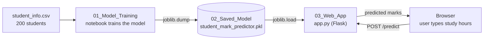

# Student Mark Predictor

A small machine-learning web app that **predicts a student's marks from the hours they study per day**.

The project shows the complete path of a machine-learning model, from data to a working web page:

> **train a model → save it as a `.pkl` file → load that file in a Flask web app → predict**

| What | Tool |
|---|---|
| Model | Simple Linear Regression (scikit-learn) |
| Saving and loading the model | joblib (`.pkl` file) |
| Web app | Flask, one HTML page |
| Data handling | pandas, NumPy |

---

## What it does

You type the hours you study per day, press **Predict Marks**, and the page answers:

> *You will get [70.13%] marks, when you do study [5] hours per day*

| Study hours | Predicted marks |
|---|---|
| 4 | 66.19 |
| 5 | 70.13 |
| 7 | 78.00 |
| 8 | 81.93 |

These predictions are reliable for **5 to 9 hours**, the range the model was trained on. See [Limitations](#limitations).

---

## How it works



The project has **three stages**. Each stage has its own folder, numbered in the order they happen.

### Stage 1: Train the model (`01_Model_Training`)

The notebook `train_student_mark_model.ipynb` does the following:

1. **Loads the data**: `student_info.csv` has 200 students with two columns, `study_hours` and `student_marks`.
2. **Cleans it**: 5 students have no `study_hours`. They are filled with the column mean (6.9959).
3. **Splits it** 80/20 with `random_state=51`: 160 students to train the model, 40 to test it.
4. **Trains** a `LinearRegression` model on the 160 training students.
5. **Evaluates** it on the 40 students it has never seen.
6. **Saves** the trained model to `../02_Saved_Model/student_mark_predictor.pkl` with `joblib.dump`.

The result is a straight line:

```
marks = 50.4474 + 3.9357 × study_hours
```

Each extra study hour adds about 3.94 marks, on average, in this data.

| Measure | Value |
|---|---|
| R² on the 40 test students | **0.9514** |
| R² on the 160 training students | 0.9590 |
| Typical error (RMSE / MAE) | 1.05 / 0.88 marks |

### Stage 2: The saved model (`02_Saved_Model`)

A **`.pkl` file is the trained model stored on disk**. Saving it means the model does not have to be trained again every time someone uses it.
This folder is the hand-off between the two other stages: the notebook writes the file, and the web app reads it.

The file holds a scikit-learn `LinearRegression` object, which for this project is just two numbers: the slope (3.9357) and the intercept (50.4474).

> **Two things to know about `.pkl` files**
> - Only load a `.pkl` file that you created or fully trust. A pickle file can run code when it is loaded.
> - Load it with the same scikit-learn version that saved it. This project uses **scikit-learn 1.7.2** (pinned in `requirements.txt`).

### Stage 3: Load the model in the web app (`03_Web_App`)

`app.py` is a small **Flask** program. When it starts, it loads the saved model **once**:

```python
MODEL_PATH = BASE_DIR.parent / "02_Saved_Model" / "student_mark_predictor.pkl"
model = joblib.load(MODEL_PATH)
```

Then it answers two kinds of requests:

| Request | What happens |
|---|---|
| Open `http://127.0.0.1:5000` | Flask returns `templates/index.html`: a box for study hours and a button |
| Press **Predict Marks** | The browser sends the hours to `/predict` (a POST request) |

What the `/predict` route does, step by step:

1. Reads the number typed in the box (`request.form`) and converts it from text to a whole number.
2. Rejects impossible values (below 0 or above 24 hours).
3. Calls `model.predict` with the hours. The model returns the predicted marks.
4. Adds the hours and the prediction to a log file, `smp_data_from_app.csv`, created in `03_Web_App` on the first prediction.
5. Returns the same page again with the answer filled in (`{{ prediction_text }}` in `index.html`).

---

## Project structure

```
Student_Mark_Predictor/
├── README.md
├── requirements.txt                 Python packages
├── .gitignore
│
├── 01_Model_Training/               STAGE 1: where the model is created
│   ├── train_student_mark_model.ipynb
│   └── student_info.csv             the data (200 students)
│
├── 02_Saved_Model/                  STAGE 2: the saved model
│   └── student_mark_predictor.pkl
│
└── 03_Web_App/                      STAGE 3: the app that loads the model
    ├── app.py                       Flask app
    ├── templates/index.html         the web page (form and result)
    └── static/images/college_banner2.png   banner shown on the page
```

---

## Getting started

You need **Python 3.10 or newer** (tested with Python 3.13).

**1. Install the packages**

```bash
python -m venv .venv
# Windows:        .venv\Scripts\activate
# macOS / Linux:  source .venv/bin/activate
pip install -r requirements.txt
```

**2. Run the web app** (the model is already saved)

```bash
cd 03_Web_App
python app.py
```

Open <http://127.0.0.1:5000>, type the study hours and press **Predict Marks**. Stop the server with `Ctrl+C`.

**3. Train the model again** (optional)

```bash
pip install notebook
cd 01_Model_Training
jupyter notebook train_student_mark_model.ipynb
```

Run all cells. The notebook reads `student_info.csv` from its own folder and writes a new `student_mark_predictor.pkl` into `02_Saved_Model`, which the app uses the next time it starts.

---

## Limitations

- **Predictions outside 5 to 9 hours are not reliable.** Every student in the data studies between 5.01 and 8.99 hours, but the app accepts 0 to 24. A straight line keeps going, so 13 hours gives 101.61 marks and 24 hours gives about 145, which is impossible. Treat anything outside 5 to 9 hours as a guess.
- **One input only.** The model uses study hours and nothing else (not attendance, sleep or earlier marks).
- **The input check is loose.** The page says "between 1 to 24" but the code accepts 0. Decimals, or an empty box sent directly to the server, make it return an error instead of a message.
- **Development server.** `app.py` uses Flask's built-in server, which is meant for testing on your own computer, not for public hosting.
- **Leftover link.** In `index.html` the button is wrapped in a link to an external page (`bit.ly/breast-cancer-ml-project`) that belongs to a different project. It can be removed.

---

## Credits

The notebook and the web app are based on the project by the **IndianAIProduction.com** team
(tutorial: <https://indianaiproduction.com/ml-project-student-mark-prediction/>).
The code in this folder was reorganised into the three stages above, commented, and updated so that it runs from any folder.
